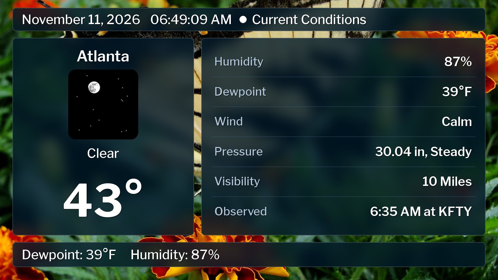
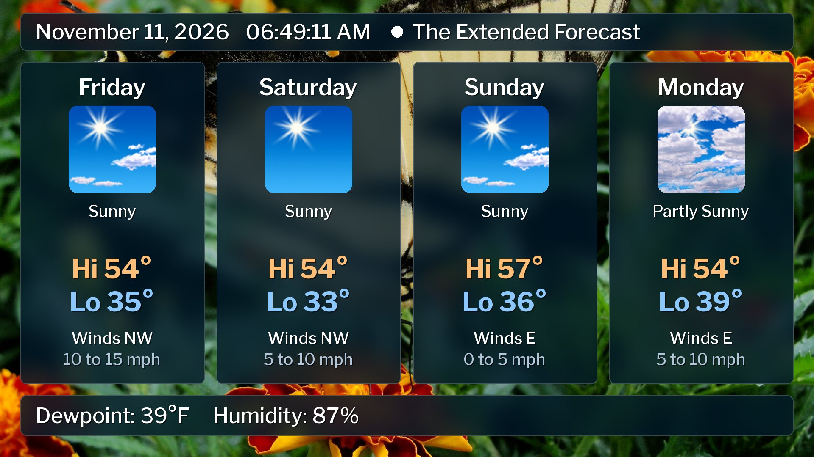
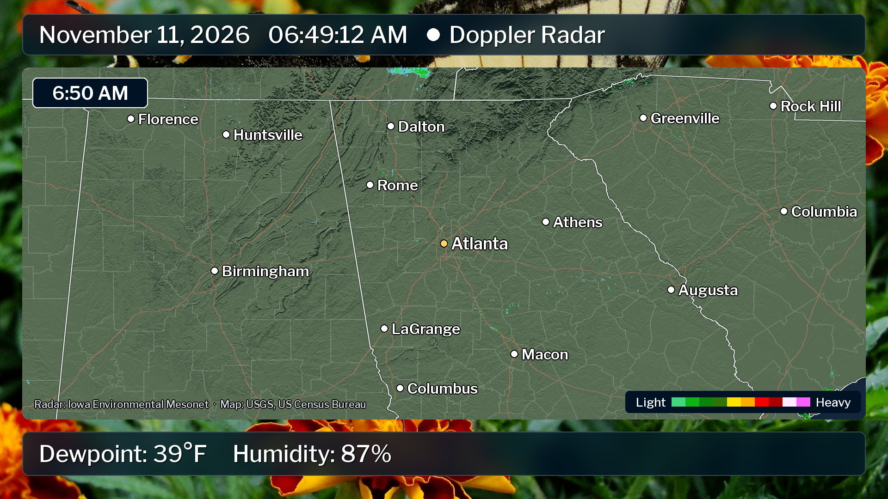

# weather

A local weather display in the spirit of a cable weather channel's "local
forecast" segment: current conditions, local observations, the 36-hour and
extended forecasts, an almanac and a Doppler radar loop, cycling over your own
photos with see-through "frosted glass" panels. Made to run all day and be
streamed.

> **⚠️ For entertainment only. Not for weather emergencies.**
> This program has no redundancy: if the internet, the computer or the
> National Weather Service's servers have a problem, warnings can be late or
> missing with no sign that anything is wrong. Never use it to alert the
> public or as anyone's main source of warnings. Get alerts from NOAA Weather
> Radio, Wireless Emergency Alerts, local media and weather.gov.
> It comes with no warranty and no liability; see [DISCLAIMER.md](DISCLAIMER.md).





It works anywhere in the US: set a ZIP code or city and everything else
(forecast office, zones, radar, time zone, nearby cities) is looked up
automatically.

## Quick start

1. Install [Python](https://www.python.org/downloads/) 3.11 or newer.
   On Windows, tick "Add python.exe to PATH" in the installer.
2. Download this repository, open a terminal in its folder and install the
   libraries:

   ```
   pip install -r requirements.txt
   ```

3. Copy `config.example.toml` to `config.toml` and set your location and
   contact info:

   ```toml
   [location]
   place = "30303"          # or "Atlanta, GA", or "33.749, -84.388"

   [nws]
   contact = "you@example.com"
   ```

4. Run it:

   ```
   python weather.py
   ```

The first time, it shows a short disclaimer. Tick the box to say you've read
it and press Continue; it won't ask again on that computer. Then it takes a
few extra seconds to build the radar map for your area, which is cached in
`cache/` after that.

### Handy options

| Command | What it does |
| --- | --- |
| `python weather.py --check` | Show what it found for your location and exit |
| `python weather.py --place "Denver, CO"` | Try another location without editing the config |
| `python weather.py --resolution 720p` | Run at 720p (or `480p`, or e.g. `1600x900`) |
| `python weather.py --fullscreen` | Full screen |
| `python weather.py --test-warning` | Show a test message in the red warning crawl |
| `python weather.py --screenshots shots` | Save a picture of every slide to `shots/` and exit |
| `python weather.py --accept-disclaimer` | Read and accept the disclaimer in the terminal instead (for a computer with no screen) |

While it's running: **Esc** quits, **F11** toggles full screen, **Right
arrow** skips to the next slide, **B** changes the background photo.

## Backgrounds

Put your own photos (`.jpg` or `.png`) in the `backgrounds/` folder. They're
cropped to fill the screen and rotated, one per cycle of slides. The panels
blur and tint whatever's behind them; adjust `panel_color`, `panel_opacity`
and `frosted` in `config.toml`.

## Slides

| Slide | Shows |
| --- | --- |
| Weather Bulletin | Full text of any watch, warning or advisory for your area (only when there is one) |
| Current Conditions | Temperature, sky, humidity, dewpoint, wind, pressure and trend, visibility, wind chill / heat index |
| Local Observations | Nearby cities' temperature, weather and wind |
| The 36 Hour Forecast | The NWS forecast text for the next three periods |
| The Extended Forecast | Four days of highs, lows, sky and wind |
| Almanac | Sunrise, sunset, twilight, daylight length and the next four moon phases |
| Doppler Radar | An animated loop over a map of your area, with warning boxes drawn on it |

The bottom bar cycles through the current conditions. When a warning is in
effect for your area, it turns red and crawls the warning text, with a beep
each time it starts over.

Pick and order the slides with `slides = [...]` in `config.toml`.

## Using it with OBS

Add a **Window Capture** of the "wxdisplay" window. Set `borderless = true`
to drop the title bar, or use `--fullscreen` on a spare monitor. The
backgrounds are drawn by the app, so no chroma key is needed. Streaming
straight to YouTube without OBS is on the [roadmap](ROADMAP.md).

## Where the data comes from

- **Forecasts, observations, alerts:** the [National Weather Service API](https://www.weather.gov/documentation/services-web-api) (public domain)
- **Radar:** the [Iowa Environmental Mesonet](https://mesonet.agron.iastate.edu/) NEXRAD composite, with the NWS radar loop images as a fallback
- **Map:** [USGS National Map](https://www.usgs.gov/programs/national-geospatial-program/national-map) shaded relief (public domain),
  [US Census Bureau](https://www.census.gov/geographies/mapping-files.html) state, county and Interstate outlines (public domain),
  and [Natural Earth](https://www.naturalearthdata.com/) for Canada and Mexico (public domain)
- **ZIP code and city lookup:** US Census Bureau Gazetteer files and population estimates (public domain),
  bundled in `assets/geo/` (rebuild with `tools/build_geodata.py`)
- **Font:** [Libre Franklin](https://github.com/googlefonts/Libre-Franklin), SIL Open Font License (`assets/fonts/OFL.txt`)

## Known limitations

- Some stations (Chattanooga and Gainesville, GA, for example) report
  temperature and wind but no sky condition, so their weather shows as "--".
- The weather icons come from the NWS, which has marked its icon service as
  deprecated. They work today, but will need replacing eventually.
- US only, °F/mph only.

## Disclaimer

This software is for entertainment and hobby use only. It is **not** a weather
alerting system, must not be used to alert the public, and must not be relied
on in a weather emergency. It is provided "as is", with no warranty, and the
author accepts no liability for any damages, injury or loss of life from its
use or failure. Read the full [DISCLAIMER.md](DISCLAIMER.md).

The program asks you to acknowledge this the first time it runs, and reminds
viewers on screen: a line in the conditions ticker, a notice after every alert
in the warning crawl, and a footer on bulletin pages. If you modify it or
remove those notices, you're responsible for the result.

## License

MIT; see [LICENSE](LICENSE). Use it, change it and share it freely. The
bundled font and data have their own (open) terms, listed under
[Where the data comes from](#where-the-data-comes-from).
